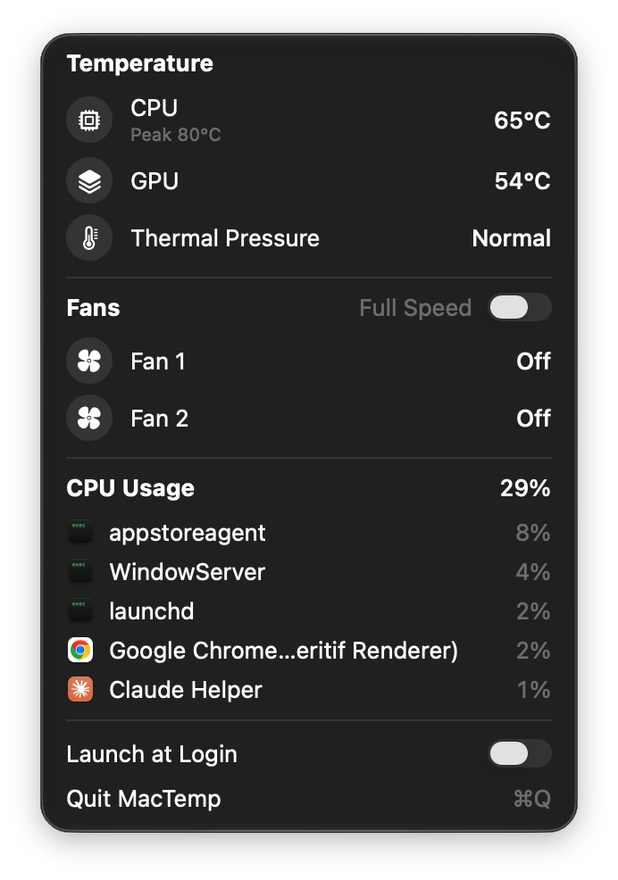
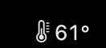
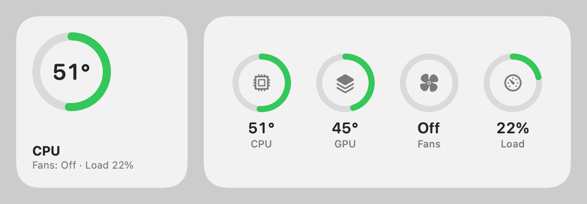
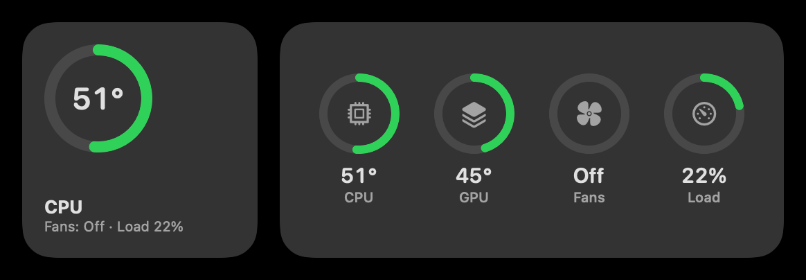
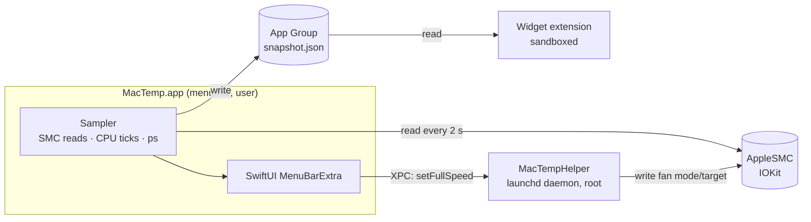

# MacTemp

A native macOS menu bar app that shows your Mac's real CPU/GPU temperatures and fan speeds, and lets you force the fans to full speed with one switch. It also comes with a desktop widget.

Built with Swift, SwiftUI, WidgetKit, IOKit and a privileged XPC helper. It has no third-party dependencies.

<p align="center">
  
</p>

| Menu bar | Widget (light / dark) |
|---|---|
|  |   |

## Why

My MacBook Pro (M3 Pro) felt hot while the fans stayed silent. macOS shows neither temperatures nor fan speeds, and I didn't want another closed-source monitoring app. So I read the sensors myself.

## Features

- **Live temperatures** for the CPU (average and peak over all core sensors) and the GPU, plus macOS thermal pressure.
- **Fan speeds** for every fan, read directly from the SMC.
- **Full Speed switch** that forces all fans to their maximum RPM. They return to automatic control when you switch it off or quit the app.
- **CPU usage** with the processes that use the most of it, shown with their app icons.
- **Desktop widget** in small and medium sizes, with activity-ring gauges in the style of Apple's Batteries widget.
- **Launch at login**, a native Control Center–style UI, and light/dark mode.

## Architecture



The work is split across three targets, because each one runs under different rules:

| Target | Runs as | Why it's separate |
|---|---|---|
| `MacTemp` | the user | Reading the SMC needs no privileges, but it isn't allowed from a sandbox. |
| `MacTempWidget` | the user, sandboxed | WidgetKit requires a sandbox, so the widget only reads the JSON snapshot the app writes into a shared App Group container. |
| `MacTempHelper` | root | Writing to the SMC returns `kIOReturnNotPrivileged` for normal users. The app registers the helper with `SMAppService.daemon`, and you approve it once in System Settings → Login Items. |

## Technical notes

**Talking to the SMC.** The System Management Controller is reached through the `AppleSMC` IOKit user client with `IOConnectCallStructMethod`. Every call exchanges an 80-byte `SMCKeyData_t` struct. Swift doesn't guarantee C struct layout, so [`SMC.swift`](Core/SMC.swift) builds the struct as a raw byte buffer at the field offsets of the C layout (key @0, dataSize @28, dataType @32, command @42, bytes @48).

**Finding sensors.** Sensor keys differ between M1, M2, M3 and M4, so nothing is hard-coded. On launch the app enumerates all of the roughly 2,400 SMC keys and keeps the float sensors with the `Tp`/`Te` prefixes (CPU performance and efficiency cores) and `Tg` (GPU). A power-gated GPU reads 0°C, so the last real value is kept.

**Forcing the fans on Apple Silicon.** Writing a fan target is not enough on M-series chips:
1. Write `Ftst = 1` to unlock manual fan control.
2. Wait until `thermalmonitord` hands control over. On an M3 Pro this takes about 5 s, during which writes to `F<n>Md` fail.
3. Write `F<n>Md = 1` (manual) and `F<n>Tg = F<n>Mx` (the max RPM, as a little-endian `Float32`).

The UI keeps the switch in the requested position until the SMC confirms the new mode, so it doesn't flicker back during the handover. A watchdog in the helper re-applies manual mode if macOS takes control back.

**Security model.** A root daemon is a liability, so this one is kept small:
- The helper exposes exactly one XPC method: full speed on or off.
- `NSXPCListener.setConnectionCodeSigningRequirement` accepts only the signed MacTemp app from the same team. The app in turn checks the helper's signature with `NSXPCConnection.setCodeSigningRequirement`.
- When the last client disconnects (the app quits or crashes), the helper restores automatic fan control and exits. launchd starts it again on demand, so after an update the new binary is always the one running.
- The team ID is read from the binary's own code signature (`SecCodeCopySigningInformation`) and is never hard-coded.

**Widget refresh.** WidgetKit limits how often widgets reload, so the widget updates roughly once a minute at best. The menu bar always shows live values.

## Requirements

- macOS 15 or later, on Apple Silicon (fan control has been tested on an M3 Pro)
- Xcode 16 or later, and an Apple Development certificate (a free Apple ID works)

## Build and install

1. Open `MacTemp.xcodeproj` and, for each of the three targets, select your team under *Signing & Capabilities* (or change `DEVELOPMENT_TEAM` in the build settings).
2. Run:
   ```bash
   ./install.sh
   ```
   This builds a Release version, installs it into `~/Applications` and launches it.
3. The first time you turn on **Full Speed**, macOS asks you to allow MacTemp in System Settings → General → Login Items.
4. To add the widget, right-click the desktop → **Edit Widgets** → search for *MacTemp*.

## Disclaimer

Running the fans at full speed is safe for the hardware, but it is loud and uses more battery. Use this software at your own risk.

## License

[MIT](LICENSE)
